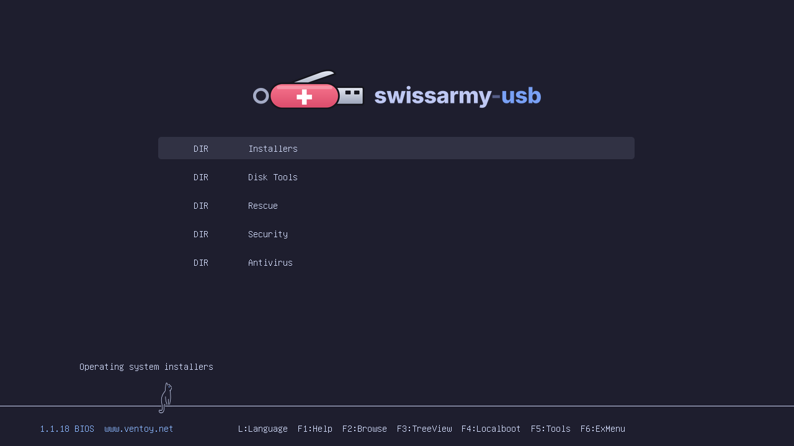
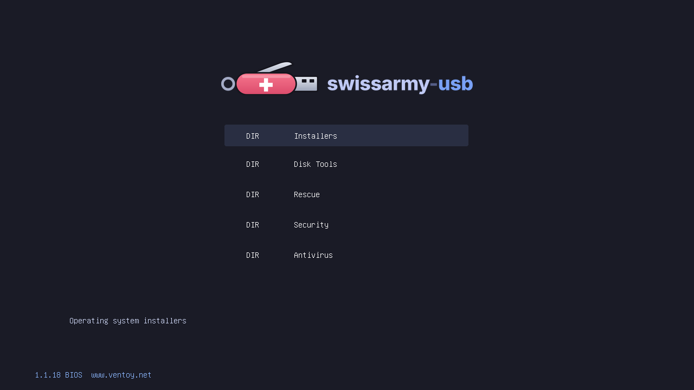
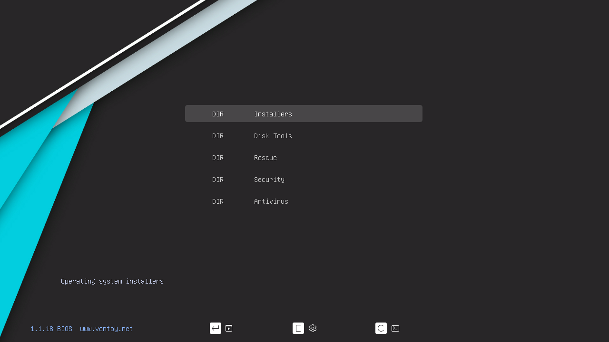

<p align="center">
  
</p>

<p align="center">
  One script to build a <b>multiboot USB stick</b> with <a href="https://www.ventoy.net">Ventoy</a>
  on Ubuntu Linux:<br>installers, disk tools, rescue systems, security distros and
  offline antivirus,<br>all on one stick with a themed boot menu.
</p>



Everything lives in this repository (pinned Ventoy release, themes, ISO
manifest, scripts) except the ISOs themselves, which `setup.sh` downloads and
verifies.

> [!IMPORTANT]
> **Clone with submodules:** the GRUB themes are git submodules:
>
> ```sh
> git clone --recursive https://github.com/migueltc13/swissarmy-usb.git
> ```
>
> Already cloned without `--recursive`? Run:
>
> ```sh
> git submodule update --init --recursive
> ```

## Quick start

```sh
cd swissarmy-usb
lsblk -o NAME,SIZE,RM,TRAN,MODEL      # find your stick, e.g. /dev/sdb
./setup.sh --dry-run all /dev/sdb     # see exactly what would happen
./setup.sh all /dev/sdb               # do it (asks you to type "sdb" first)
```

`all` runs `deps` → `install` → relabel the data partition `SWISSARMY` →
`themes` → `isos` → `config`. It stops and asks you to type the device name
before the one destructive step. The full set is about 46 GB today, so use a
64 GB stick.

Windows 10/11 and Redo Rescue can't be downloaded automatically. Download them
yourself, then:

```sh
./setup.sh isos --from ~/Downloads windows redorescue
```

Then boot it in a VM to check: `./setup.sh test /dev/sdb`.

## What ends up on the stick

```
SWISSARMY/                        exFAT data partition
├── 1-Installers/
│   ├── archlinux.iso
│   ├── omarchy.iso
│   ├── ubuntu-24.04-desktop.iso
│   ├── kali-netinst.iso
│   ├── windows10.iso             manual download
│   └── windows11.iso             manual download
├── 2-Disk-Tools/
│   ├── clonezilla.iso
│   └── gparted.iso
├── 3-Rescue/
│   ├── boot-repair-disk.iso
│   ├── redorescue.iso            manual download
│   └── systemrescue.iso
├── 4-Security/
│   ├── kali-live.iso
│   ├── tails.iso
│   └── caine.iso
├── 5-Antivirus/
│   ├── antivirus-livecd.iso      4MLinux + ClamAV
│   └── krd.iso                   Kaspersky Rescue Disk
├── Files/                        free space for your files (not scanned)
│   ├── .ventoyignore
│   ├── isos.md                   generated ISO list: version, date, SHA256…
│   └── .swissarmy/               download state ("up to date" checks)
└── ventoy/
    ├── ventoy.json               generated config: themes, aliases, tips
    ├── theme/                    catppuccin-mocha/, tokyo-night/, vimix/
    └── persistence/              optional *.dat persistence images
```

ISO filenames on the stick have no version in them (`kali-live.iso`), so menu
aliases and tips keep working across updates. Only amd64/x86_64 images are used.

## Commands

Every command accepts `--dry-run` (`-n`): it prints what would happen and
changes nothing. Resolving versions and checking signatures still runs, since
it only reads.

Where a command takes `[mount|device]` you can pass the mountpoint
(`/media/$USER/SWISSARMY`), the device (`/dev/sdb`, which is mounted with
`udisksctl` if needed), or nothing at all: a mounted stick labelled
`SWISSARMY` or `Ventoy` is found automatically.

| Command                                        | What it does                                                                                                                             |
| ---------------------------------------------- | ---------------------------------------------------------------------------------------------------------------------------------------- |
| `deps [--qemu]`                                | `apt install` git, curl, jq, gnupg, aria2, pv, exfatprogs, dosfstools, parted, xz-utils, udisks2 (+ qemu-system-x86, ovmf with `--qemu`) |
| `install <device>`                             | Install Ventoy with GPT + Secure Boot (`Ventoy2Disk.sh -I -g -s`). **Wipes the device.**                                                 |
| `update <device>`                              | Update Ventoy on an existing stick (`Ventoy2Disk.sh -u`). Keeps ISOs and config.                                                         |
| `themes [mount\|device]`                       | Copy the three GRUB themes to `ventoy/theme/`                                                                                            |
| `isos [mount\|device] [id…]`                   | Download, verify and place ISOs (all, or just the given ids)                                                                             |
| `config [mount\|device]`                       | Regenerate `ventoy/ventoy.json` and `Files/isos.md`                                                                                      |
| `persistence <name> [mount\|device] --size MB` | Create `ventoy/persistence/<name>.dat`                                                                                                   |
| `test <device\|image> [--uefi]`                | Boot the stick in QEMU                                                                                                                   |
| `all <device>`                                 | Everything above, in order                                                                                                               |
| `ventoy-bump <version>`                        | Vendor a different Ventoy release                                                                                                        |

Examples:

```sh
./setup.sh deps --qemu
./setup.sh install /dev/sdb
./setup.sh update /dev/sdb
./setup.sh themes                          # auto-detects the mounted stick
./setup.sh isos                            # everything in isos.conf
./setup.sh isos kali tails                 # "kali" = kali-netinst + kali-live
./setup.sh isos /media/$USER/SWISSARMY gparted
./setup.sh isos --from ~/Downloads windows # copies Win10_*/Win11_* ISOs
./setup.sh -n isos                         # show what is outdated, download nothing
./setup.sh config
./setup.sh persistence kali --size 4096
./setup.sh test /dev/sdb --uefi
./setup.sh ventoy-bump 1.1.19
```

`themes`, `isos` and `persistence` regenerate the config when they finish, so
you rarely need to run `config` by hand.

### Safety

`install` (and `all`) erase the target, so they:

- only accept whole disks (`/dev/sdb`, not `/dev/sdb1`);
- refuse disks that are neither removable nor USB (`lsblk -o RM,TRAN`);
- refuse a disk with a system mount (`/`, `/boot`, `/home`, swap, …) or any
  filesystem mounted outside `/media`, `/run/media` or `/mnt`, and refuse the
  disk that holds `/`;
- show `lsblk` details and make you **type the device name** to continue;
- unmount the stick's partitions before Ventoy runs.

Nothing runs the destructive step without that typed confirmation. There is no
`--yes`.

Ventoy's scripts write logs and unpack tools into their own directory as root,
so `setup.sh` runs them from a temporary copy and the vendored tree stays
clean.

### ISO downloads

For every ISO, `isos`:

1. finds the latest release (or the pinned one) with a resolver for that source;
2. skips it if the same version is already on the stick;
3. downloads it, resuming partial downloads (`curl -C -`; Kali Live is only
   seeded as a torrent, so that one uses `aria2c`);
4. checks the SHA256, plus the GPG signature where upstream signs its releases
   (Arch, Ubuntu, Kali, Tails, Clonezilla, SystemRescue). Signatures are checked
   against a pinned key fingerprint in a throwaway keyring;
5. deletes and reports anything that fails, keeping the previous ISO in place.

Kaspersky Rescue Disk publishes no checksum, so it is downloaded over HTTPS
without one and flagged in the output. `isos` exits non-zero if any ISO failed;
missing manual ISOs are reported but are not errors.

## Adding an ISO

Add a section to [`isos.conf`](isos.conf):

```ini
[gparted]
folder  = 2-Disk-Tools          # one of the [folder:…] sections
file    = gparted.iso           # name on the stick, no version
alias   = GParted Live          # menu name
tip     = Graphical partition editor
lang    = Multilingual          # optional
source  = gparted               # resolver (+ args), or "manual"
verify  = sha256                # sha256 | sha256+gpg | none
# gpg_key = https://…/key.asc   # with sha256+gpg
# gpg_fpr = 0123…CDEF           # with sha256+gpg
# pin     = 1.8.1-6             # optional
```

Then run `./setup.sh isos gparted`.

Available sources (in [`lib/resolvers.sh`](lib/resolvers.sh)): `arch`,
`omarchy`, `ubuntu <flavor>`, `kali <variant>`, `tails`, `clonezilla`,
`gparted`, `systemrescue`, `caine`, `krd`, and `sourceforge <project> [regex]`.
The `sourceforge` source works for any SourceForge project whose main download
is the ISO you want, and the regex guards against that download changing.

For a project without a resolver, write `resolve_<name>()`. It sets `R_VERSION`,
`R_URL` and either `R_SHA256` or `R_SUMS_URL`, plus optionally `R_SIG_URL` and
`R_SIG_OF` (`sums` or `iso`). The existing resolvers are 5–15 lines each.

For something that can't be downloaded by a script, use `source = manual` with
`url = …` (shown to the user) and `match = Name_*.iso` (searched in `--from`).

### Version pinning

`pin` is optional. Without it, an entry tracks the latest release.

- **Ubuntu is pinned to `24.04`**: the resolver picks the newest 24.04.x point
  release (24.04.5.1 today), never 24.10 or 26.04. The `ubuntu` source
  requires a pin.
- `arch` (e.g. `2026.11.01`), `kali` (`2026.3`), `omarchy`, `systemrescue`
  and `caine` accept an exact version.
- `tails`, `clonezilla`, `gparted`, `sourceforge` and `krd` only serve their
  current release, so pinning them is an error.

## Themes

Three GRUB2 themes are included as submodules and copied to
`<stick>/ventoy/theme/<name>/`. Each must contain a `theme.txt`, and
`setup.sh` checks this.

| Catppuccin Mocha                                                     | Tokyo Night                                                           | Vimix                                                                   |
| -------------------------------------------------------------------- | --------------------------------------------------------------------- | ----------------------------------------------------------------------- |
|  |             |                           |
| [catppuccin/grub](https://github.com/catppuccin/grub)                | [mino29/tokyo-night-grub](https://github.com/mino29/tokyo-night-grub) | [vinceliuice/grub2-themes](https://github.com/vinceliuice/grub2-themes) |

Vimix is generated, not copied:
`install.sh -t vimix -i color -s 1080p -g <outdir>`.

**Picking a theme.** `default_file` in
[`config/ventoy.json.tmpl`](config/ventoy.json.tmpl) chooses the theme:
`1` (the default), `2`, `3` select Catppuccin, Tokyo Night or Vimix, and `0`
picks one at random on every boot. Run `./setup.sh config` after changing it.
`gfxmode` is a list tried in order: `1280x720` keeps the menu text large on
small laptop screens and scales cleanly to 1080p, with `auto` as a fallback
for firmware that doesn't offer it.

**Our tweaks.** `assets/themes/<name>/` is copied over a theme on the stick:
Catppuccin and Tokyo Night get the swissarmy-usb logo and a `theme.txt` laid
out so all five sections fit at 720p. The logo sources are the SVGs in
[`.github/assets/logo/`](.github/assets/logo).

Other theme settings (`gfxmode`, `display_mode`) and Ventoy options (`control`,
`menu_tip` position and colour) live in the same template. Values in the
generated lists (theme files, aliases, tips, persistence) are merged into the
template.

**Your own themes.** Ventoy supports any GRUB2 theme. Copy its folder (with
`theme.txt`) to `<stick>/ventoy/theme/<name>/` and run `./setup.sh config`.
It is added to the list after the built-in three.

## Secure Boot

Ventoy is installed with Secure Boot support (`-s`). **The first time** you boot
the stick on a machine with Secure Boot enabled, you get a blue _MokManager_
screen:

1. choose **Enroll key from disk**;
2. select the `VTOYEFI` partition, then `ENROLL_THIS_KEY_IN_MOKMANAGER.cer`;
3. **Continue** → **Yes** → **Reboot**.

This **permanently adds Ventoy's key to that machine's MOK list**, which then
trusts anything signed with it. Do it only on machines where that is
acceptable. You can remove the key later with `mokutil --delete`. Each machine
asks once.

## Persistence

Persistence is optional and off unless you create an image:

```sh
./setup.sh persistence kali --size 4096
```

This creates `ventoy/persistence/kali.dat` with Ventoy's
`CreatePersistentImg.sh` (ext4, label `persistence`, with a `persistence.conf`
containing `/ union`) and adds a `persistence` entry for
`/4-Security/kali-live.iso` to ventoy.json. When booting Kali, Ventoy asks
whether to use the image. Pick it, then choose Kali's _Live USB Persistence_
boot entry.

Ubuntu also works (`./setup.sh persistence ubuntu --size 4096`, label
`casper-rw`). An entry supports persistence when it has a `persistence = <label>`
line in `isos.conf`.

> [!NOTE]
> **Tails' Persistent Storage does not work through Ventoy.** Tails only
> creates its encrypted storage on a stick it was installed to with its own
> installer. Booting `tails.iso` from Ventoy works, but always amnesic. For
> Persistent Storage, give Tails its own stick.

## Updating

- **ISOs:** `./setup.sh isos` downloads whatever changed upstream and skips the
  rest.
- **Ventoy on the stick:** `./setup.sh update /dev/sdb` (non-destructive `-u`).
- **The vendored Ventoy:** `./setup.sh ventoy-bump <version>` downloads that
  Linux release from GitHub, checks it against the release's `sha256.txt`,
  replaces `ventoy/ventoy-*/`, adds Ventoy's `COPYING` and rewrites
  `ventoy/VERSION`. Review and commit it, then run `update` on your sticks.
- **Themes:** `git submodule update --remote`, then `./setup.sh themes`.

## Testing without a real stick

Don't experiment on real disks. Use a loop device:

```sh
truncate -s 8G stick.img
LOOP=$(sudo losetup --show -fP stick.img)
SWISSARMY_ALLOW_LOOP=1 ./setup.sh install "$LOOP"   # loop devices need this opt-in
./setup.sh themes "$LOOP"
./setup.sh test stick.img --uefi
sudo losetup -d "$LOOP"
```

`shellcheck -x setup.sh lib/*.sh` should stay clean.

## Licenses

- This repository's scripts and config: [MIT](LICENSE).
- Ventoy (vendored in `ventoy/`): **GPLv3**, see `ventoy/ventoy-*/COPYING`.
- Themes keep their own licenses: Catppuccin GRUB (MIT), Tokyo Night GRUB
  (MIT), grub2-themes/Vimix (GPLv3). See each submodule's `LICENSE`.
- The ISOs belong to their projects and are downloaded from them. None are
  committed here, and `.gitignore` excludes `*.iso`, `*.img` and `*.dat`.
